# Casos de uso

Cada columna es un actor. El administrador hereda la columna del servidor público. Predial, agua, multas y la licencia de funcionamiento incluyen el pago, y el pago incluye el recibo.

```mermaid
flowchart LR
  subgraph ventanilla [Ciudadano en ventanilla]
    direction TB
    hu01(["HU-01 Predial"])
    hu02(["HU-02 Agua"])
    hu04(["HU-04 Multas"])
    hu05(["HU-05 Construcción"])
    hu06(["HU-06 Seguimiento"])
    hu08(["HU-08 Pago"])
    hu07(["HU-07 Recibo"])
    hu01 ~~~ hu02
    hu02 ~~~ hu04
    hu04 ~~~ hu05
    hu05 ~~~ hu06
    hu06 ~~~ hu08
    hu08 --> hu07
  end

  subgraph ciudadDigital [Ciudadano en ciudad digital]
    direction TB
    hu18(["HU-18 Registro y 2FA"])
    hu19(["HU-19 Foros"])
    hu20(["HU-20 Encuestas"])
    hu22(["HU-22 Chat"])
    hu23(["HU-23 Alertas"])
    hu24(["HU-24 Incidencias"])
    hu25(["HU-25 Eventos"])
    hu18 ~~~ hu19
    hu19 ~~~ hu20
    hu20 ~~~ hu22
    hu22 ~~~ hu23
    hu23 ~~~ hu24
    hu24 ~~~ hu25
  end

  subgraph comercio [Comerciante]
    direction TB
    hu03(["HU-03 Licencia"])
    hu21(["HU-21 PyME"])
    hu03 ~~~ hu21
  end

  subgraph oficina [Servidor público y administrador]
    direction TB
    bandeja(["Dictaminar bandeja"])
    contratosAgua(["Contratos de agua"])
    respuestaForo(["Respuesta en foros"])
    publicar(["Publicar encuesta o evento"])
    alertaPrueba(["Alerta de prueba"])
    bandeja ~~~ contratosAgua
    contratosAgua ~~~ respuestaForo
    respuestaForo ~~~ publicar
    publicar ~~~ alertaPrueba
  end
```

