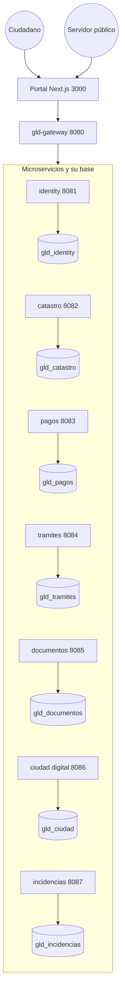

# Diagrama de arquitectura

El portal solo habla con el gateway. Cada fila es un servicio y la base de la que es dueño. No hay llaves foráneas entre bases.

Las llamadas entre servicios no pasan por el gateway. Van al puerto del servicio con el encabezado `X-Internal-Token`.

| Desde | Hacia | Para qué |
| --- | --- | --- |
| identity | ciudad digital | crear el perfil al registrarse |
| ciudad digital | identity | saber si el TOTP está activo |
| pagos | catastro | leer el predio o el contrato y marcarlo pagado |
| pagos | trámites | avisar que el trámite quedó pagado |
| pagos | documentos | emitir el recibo |
| trámites | pagos | cotizar y liquidar la licencia |
| trámites | catastro | validar la clave catastral |
