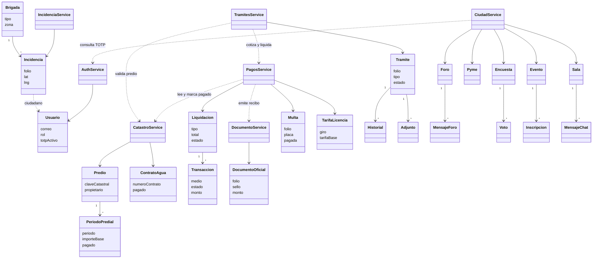

# Diagrama de clases

Modelo de dominio. El controlador devuelve un DTO y no aparece aquí. La flecha punteada es una llamada HTTP interna.

Preferencia de alerta y alerta enviada viven en ciudad digital, con el mismo corte servicio-entidad, y están en el esquema de `gld_ciudad`.
