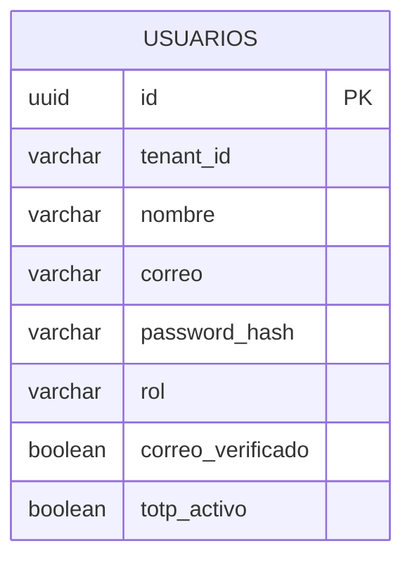
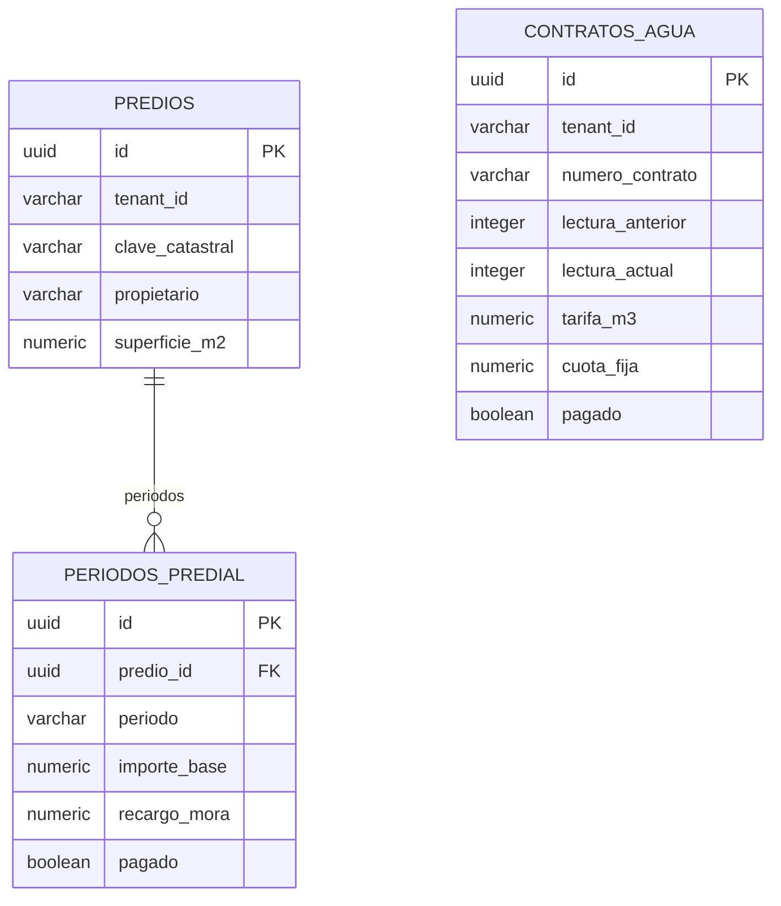
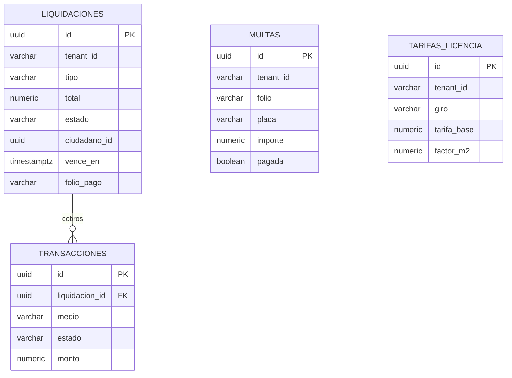
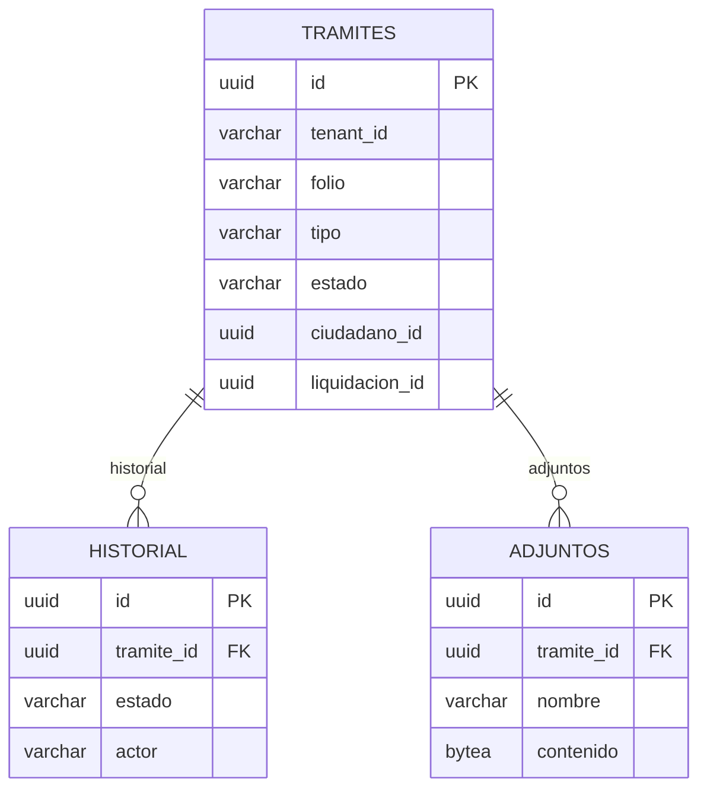
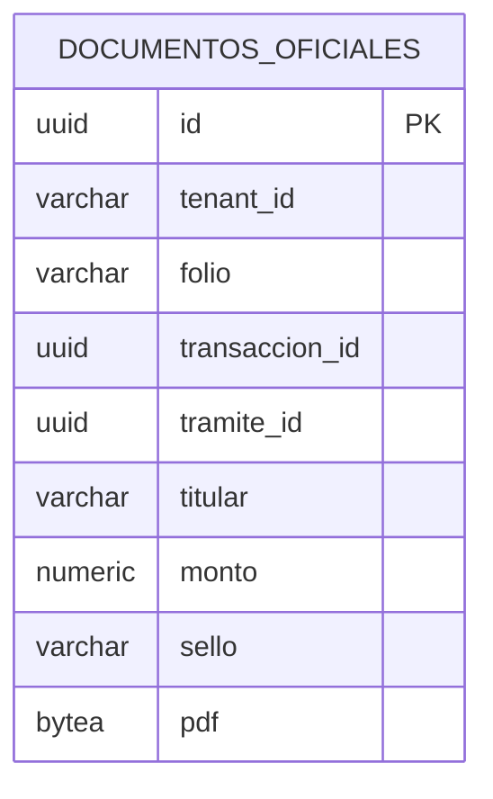
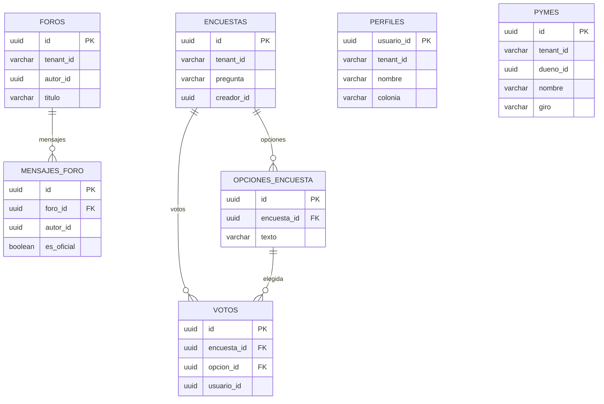
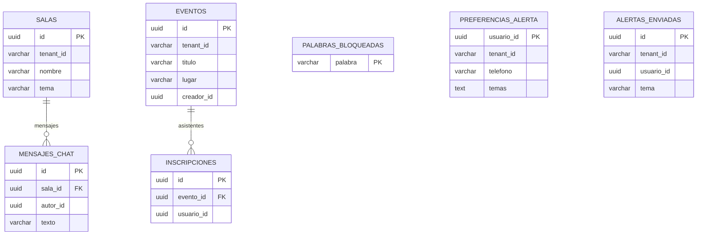
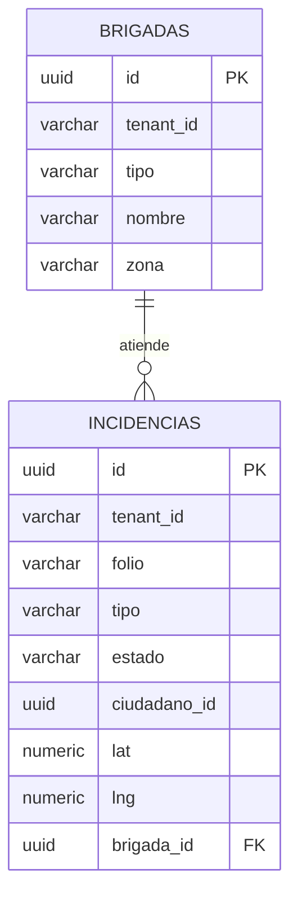

# Esquemas de la base de datos

Siete bases en el mismo contenedor. La llave foránea solo existe dentro de su base. `ciudadano_id`, `liquidacion_id`, `transaccion_id`, `tramite_id` y `usuario_id` apuntan a otra base sin restricción. La unicidad de negocio es `tenant_id` más la clave natural (correo, folio, clave catastral, contrato, giro).

Pagos, trámites, ciudad e incidencias tienen además `bitacora` (`id`, `tenant_id`, `ocurrio_en`, `actor_id`, `accion`, `recurso`, `referencia`, `detalle`), sin relación con el resto de tablas.

Cada base tiene su diagrama. `gld_ciudad` va en dos porque tiene catorce tablas. Las columnas son las principales; el detalle está en `database/sql`.

## gld_identity

## gld_catastro

## gld_pagos

## gld_tramites

## gld_documentos

## gld_ciudad

Foros, encuestas y directorio:

Chat, alertas y agenda. Un voto y una inscripción son únicos por ciudadano.

## gld_incidencias

PostGIS solo en esta base. `geom` se genera a partir de `lat` y `lng`.

